# Memoria · Vídeos con avatares

**Autora: Araceli Fradejas Muñoz**  
**Fecha de esta edición: 2 de noviembre de 2026**

## Vídeos publicados

El proyecto se puede ver en dos formatos, publicados en [mi canal de YouTube](https://www.youtube.com/@AraceliFradejas) el 2 de noviembre de 2026:

- **[Vídeo largo con mi avatar personal de Synthesia](https://www.youtube.com/watch?v=hC1neS7fEbk) · 8 min 30 s.** Explico el propósito del proyecto, el flujo de integración, los diagramas y el criterio de producción. La presentación se ha preparado en el editor de Synthesia y la música de Suno se ha incorporado posteriormente con FFmpeg.
- **[Short de Arucci](https://www.youtube.com/shorts/Gher00dWO8s) · 59 s.** Presenta de forma breve el proceso que conecta guion, ElevenLabs, HeyGen, Mermaid, FFmpeg y la creación musical con Suno.

Son dos relatos adaptados a su formato. Los enlaces permiten consultar el resultado público; los archivos originales de vídeo, voz y música permanecen fuera de Git.

## Motivación

Cuando termino un proyecto de desarrollo, quiero mostrar algo más que una lista de tecnologías. Me interesa explicar el problema, enseñar el resultado y contar las decisiones que he tomado. En mi portfolio, esa comunicación se repite con cada proyecto y necesita guiones, imágenes y montaje.

Este sistema surge para organizar ese trabajo. Mi objetivo es tener un proceso que pueda reutilizar y adaptar, y compartirlo para que otras personas expliquen sus propios proyectos con su voz y su avatar.

## Objetivos

- Dividir cada historia en escenas con un texto y un recurso visual definidos.
- Producir un formato vertical para redes y preparar un guion largo para YouTube.
- Conectar generación de voz, avatar y montaje mediante configuraciones y scripts.
- Representar el proceso con diagramas que también se puedan editar como texto.
- Incorporar música instrumental creada para el proyecto.
- Mantener las claves y los recursos personales fuera del repositorio público.
- Documentar qué se automatiza y qué reviso personalmente.

## Dos maneras de contar una misma historia

En el formato vertical utilizo a **Arucci**, mi avatar. Habla de mí en tercera persona y presenta una idea técnica con apoyo visual. La grafía del nombre es Arucci y en los textos hablados utilizo «Aruchi» para orientar la pronunciación.

En el vídeo largo utilizo mi avatar personal de **Synthesia** y narro en primera persona. Ese espacio permite desarrollar la motivación, las decisiones y los aprendizajes. El largo tiene su propio guion; no consiste en alargar el texto del corto.

## Desarrollo del proceso

### 1. Guion y escenas

Parto de una historia concreta y decido qué debe entender quien la vea. Divido la narración en escenas y asocio a cada una una imagen. El JSON guarda el texto hablado y el nombre del recurso visual; el Markdown permite revisar el relato completo.

### 2. Diagramas con Mermaid

Los diagramas explican relaciones y pasos del proceso. Los guardo en archivos `.mmd` y los exporto a PNG mediante Mermaid CLI. Esto permite versionar cambios, reutilizar los gráficos y mostrar su código directamente en GitHub.

Para el móvil distribuyo el contenido en varios planos. El ejemplo utiliza ocho diagramas: recorrido general, escenas, voz, sincronización del avatar, montaje, música y revisión, formatos y reutilización.

### 3. Voz con ElevenLabs

Un script genera un MP3 por escena y mide su duración con FFmpeg. Con esos datos construye los tiempos del montaje y el audio unido. La caché comprueba el texto y la voz para reutilizar escenas sin cambios y regenerar las que se han modificado.

Los tiempos se obtienen de los archivos de audio: no son una alineación por palabra. La sincronización final debe comprobarse con el vídeo descargado.

### 4. Avatar con HeyGen

El audio se sube a HeyGen y se solicita un vídeo con el avatar configurado. La generación devuelve un identificador de trabajo, que sirve para consultar el estado y descargar el resultado cuando termina. La generación de voz y la imagen del avatar permanecen como operaciones distintas.

### 5. Banda sonora con Suno

He incorporado una pista instrumental, **Warm Analog Pad**, creada con Suno y descargada en MP3. La dirección musical busca sintetizadores cálidos, ritmo contenido y espacio para que se entienda la narración.

La creación musical se realiza en Suno y la descarga es manual. Después FFmpeg incorpora el archivo al vídeo, reduce su presencia bajo la voz y aplica entrada y salida progresivas. El repositorio comparte el proceso y un prompt de referencia; no distribuye la pista personal.

### 6. Montaje y subtítulos

FFmpeg combina el avatar arriba y los gráficos abajo en una composición 50/50. Los tiempos de la narración determinan la permanencia de cada imagen. El resultado se exporta en vertical 1080 × 1920 y se conserva también una versión sin música.

Los subtítulos se entregan en un archivo SRT independiente. El generador produce un bloque por escena; si se necesita una lectura más ágil, esos bloques se pueden dividir en frases en un editor.

### 7. Vídeo largo

He preparado la presentación larga en el editor de Synthesia con mi avatar personal y los recursos visuales del guion. El [resultado publicado](https://www.youtube.com/watch?v=hC1neS7fEbk) dura 8 min 30 s. Después de exportar la fuente sin música, he incorporado *Warm Analog Pad* con FFmpeg. El repositorio incluye también una configuración y scripts para utilizar la API cuando una cuenta y un avatar tengan acceso compatible; esa alternativa no fue la utilizada para producir este largo.

## Esquemas detallados del vídeo de Synthesia

Para desarrollar la explicación del vídeo largo he preparado **14 láminas para sus diez bloques narrativos**. Amplían los ocho gráficos del corto y permiten explicar con más detalle las relaciones entre herramientas, los archivos que se intercambian y las decisiones de producción.

Las imágenes están en formato **16:9, 1920 × 1080**, sin rótulos de escena ni tiempos incrustados. Cada una se puede abrir a tamaño completo. Conservo también la fuente Mermaid y una versión SVG vectorial en el [índice de esquemas](docs/esquemas-synthesia/README.md).

La leyenda distingue operaciones de scripts o generación en **turquesa**, decisiones y tareas manuales en **ámbar**, archivos y resultados en **azul**, y siguientes pasos o estados pendientes en **lila discontinuo**. Los colores ayudan a leer el flujo; no representan una validación automática de derechos ni una certificación de gobierno de IA.

### 1. Del proyecto técnico a una historia comprensible

<a href="docs/esquemas-synthesia/png/01-reto.png">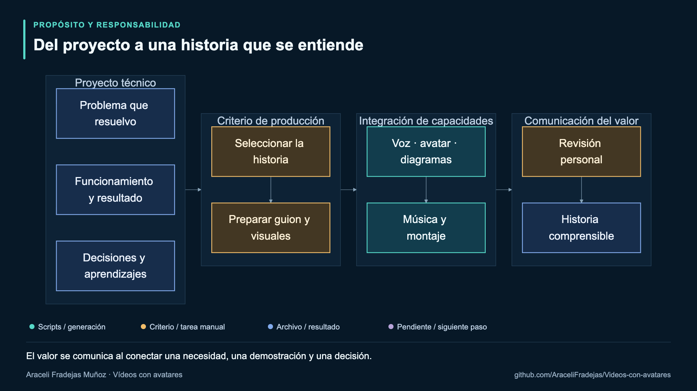</a>

La explicación empieza en el proyecto: el problema que resuelve, su funcionamiento y las decisiones que he tomado. A partir de esos elementos selecciono una historia y preparo el guion y los visuales. Después conecto voz, avatar, diagramas, música y montaje para convertirla en una presentación que se pueda seguir.

El gráfico separa las capacidades de generación de las decisiones de producción. Elegir qué contar y revisar el resultado son tareas personales. La integración me ayuda a producir la historia, pero su claridad depende también de cómo organizo y presento el contenido.

[Fuente Mermaid](docs/esquemas-synthesia/mermaid/01-reto.mmd) · [Versión vectorial](docs/esquemas-synthesia/svg/01-reto.svg)

### 2. Propósito, escenas y dos formatos

<a href="docs/esquemas-synthesia/png/02-proposito.png">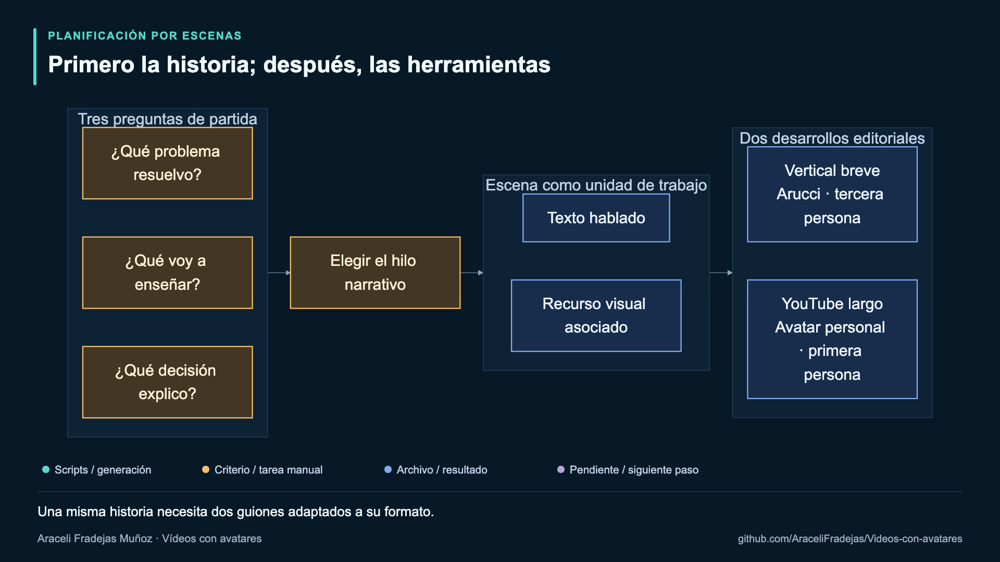</a>

Antes de generar contenido me planteo tres preguntas: qué problema resuelvo, qué voy a enseñar y qué decisión quiero explicar. Estas preguntas me ayudan a elegir el hilo narrativo y a evitar que la presentación se convierta en una enumeración de herramientas.

Cada escena combina texto hablado y un recurso visual. A partir de esa estructura preparo un guion breve para Arucci, en tercera persona, y otro desarrollado para mi avatar personal, en primera persona. Comparten el tema y las evidencias, pero la selección y el ritmo de la explicación se adaptan al formato.

[Fuente Mermaid](docs/esquemas-synthesia/mermaid/02-proposito.mmd) · [Versión vectorial](docs/esquemas-synthesia/svg/02-proposito.svg)

### 3. Guion, configuración y gráficos editables

<a href="docs/esquemas-synthesia/png/03-archivos.png">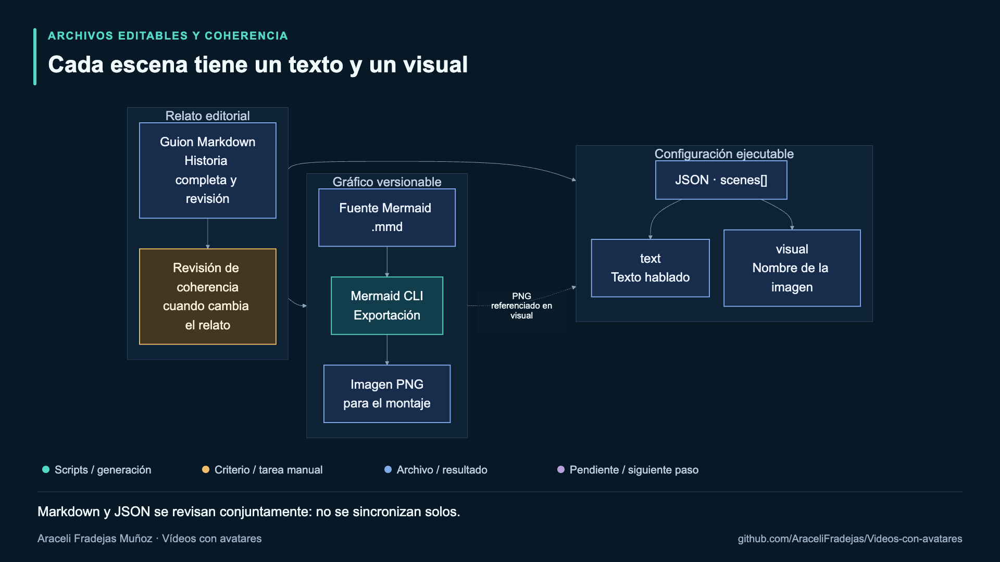</a>

El Markdown conserva el relato completo para su lectura editorial. El JSON contiene las escenas que utilizan los scripts: el campo `text` guarda la narración y `visual` identifica la imagen correspondiente. Las fuentes Mermaid se exportan a PNG mediante Mermaid CLI; ese PNG es el recurso referenciado en la configuración.

La relación entre estos archivos permite revisar el proceso sin ocultarlo dentro de una herramienta. También exige mantenerlos coherentes: editar el Markdown no actualiza automáticamente el JSON y cambiar un gráfico requiere volver a exportar su imagen. Las flechas representan estas relaciones entre recursos, no un sincronizador automático.

[Fuente Mermaid](docs/esquemas-synthesia/mermaid/03-archivos.mmd) · [Versión vectorial](docs/esquemas-synthesia/svg/03-archivos.svg)

### 4. Voz por escenas, caché y tiempos reales

<a href="docs/esquemas-synthesia/png/04-voz.png">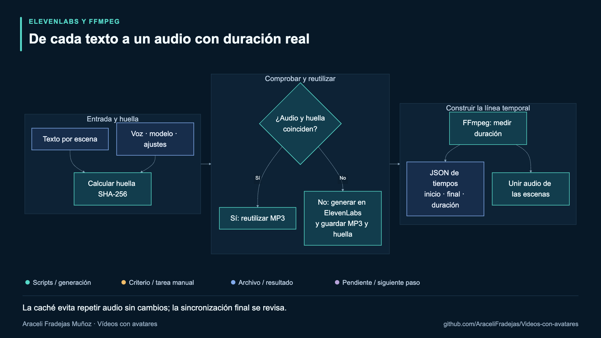</a>

El script de ElevenLabs trabaja por escenas. Calcula una huella a partir del texto, la voz, el modelo y los ajustes contemplados por la caché. Si encuentra un MP3 y una huella coincidentes, reutiliza el audio; si no, solicita una generación y guarda el resultado y su huella.

FFmpeg mide la duración de los archivos para construir un JSON con inicio, final y duración por escena. También se prepara el audio unido que se enviará a HeyGen. Estos tiempos ayudan a ordenar los visuales y a crear el SRT; no son una alineación por palabra y deben contrastarse con el vídeo descargado.

[Fuente Mermaid](docs/esquemas-synthesia/mermaid/04-voz.mmd) · [Versión vectorial](docs/esquemas-synthesia/svg/04-voz.svg)

### 5. Generación asíncrona y conservación del identificador

<a href="docs/esquemas-synthesia/png/05-heygen.png">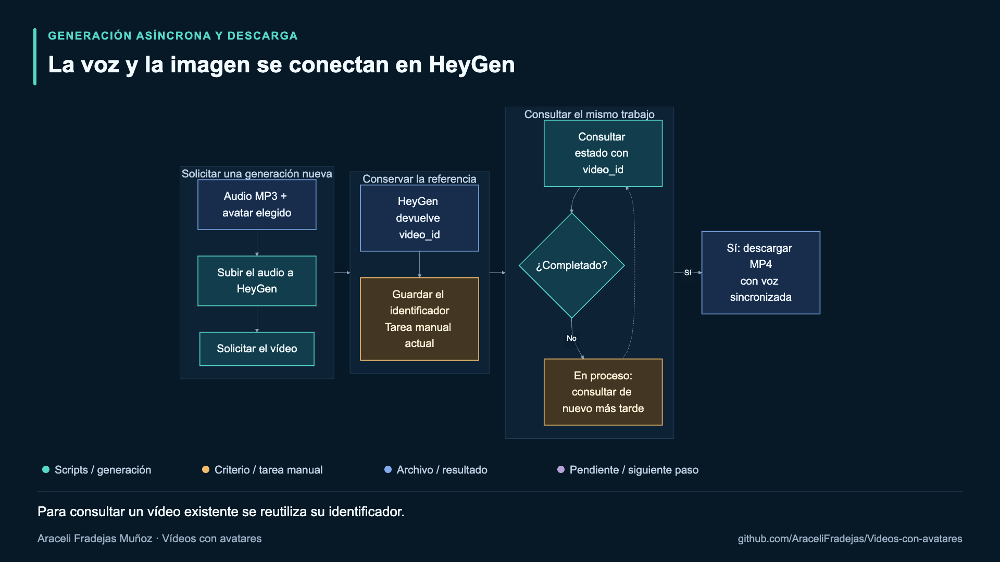</a>

HeyGen recibe el audio creado y la referencia al avatar configurado. El comando de generación sube ese audio y solicita un vídeo nuevo; la respuesta proporciona un `video_id`. Otro comando consulta ese identificador y descarga el MP4 cuando el trabajo está completado.

Guardar la referencia es una tarea manual del flujo actual. Si el trabajo sigue en proceso, debo consultar el mismo identificador más tarde. Volver a ejecutar el generador solicita otro vídeo, por lo que distinguir generación y consulta ayuda a evitar repeticiones involuntarias. El kit todavía no mantiene un registro automático de trabajos.

[Fuente Mermaid](docs/esquemas-synthesia/mermaid/05-heygen.mmd) · [Versión vectorial](docs/esquemas-synthesia/svg/05-heygen.svg)

### 6. Entradas del montaje y composición vertical

<a href="docs/esquemas-synthesia/png/06a-montaje.png">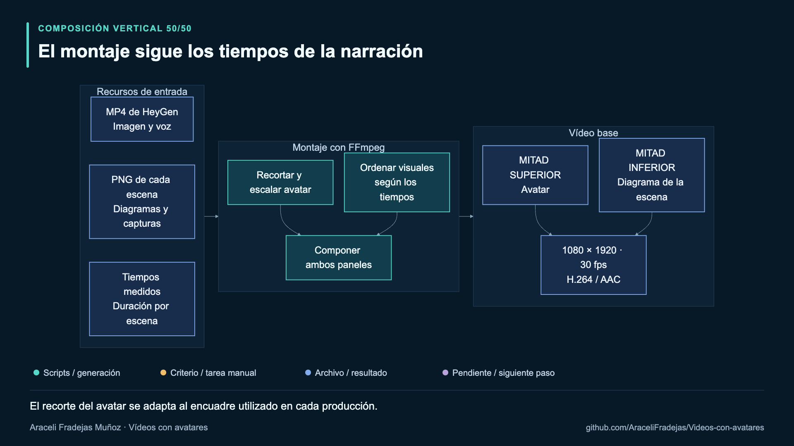</a>

El montaje combina tres entradas: el vídeo del avatar con su voz, los PNG de cada escena y los tiempos de la narración. FFmpeg recorta y escala la fuente del avatar, ordena los visuales y compone los dos paneles: imagen del avatar arriba y explicación gráfica abajo.

El formato de referencia es 1080 × 1920, a 30 fps y con códecs H.264/AAC. El recorte está ajustado a una fuente de 720 × 1280 y a su encuadre concreto. Con otro avatar debo revisarlo y adaptarlo; la composición no incluye detección automática de la cara ni ajuste universal del encuadre.

[Fuente Mermaid](docs/esquemas-synthesia/mermaid/06a-montaje.mmd) · [Versión vectorial](docs/esquemas-synthesia/svg/06a-montaje.svg)

### 7. Dirección musical, creación en Suno y mezcla local

<a href="docs/esquemas-synthesia/png/06b-suno.png">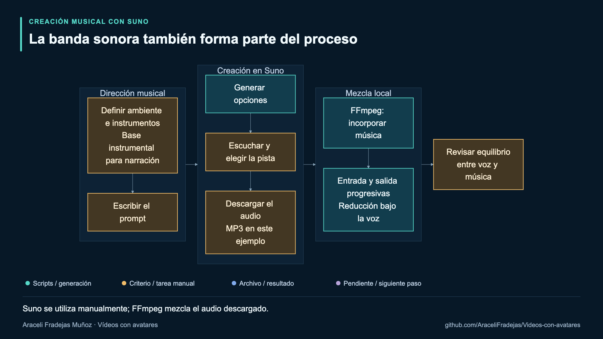</a>

La música empieza por una decisión de producción: qué ambiente quiero transmitir y cuánto espacio debe dejar a la narración. Defino instrumentos y ritmo en un prompt, genero opciones en Suno, escucho los resultados y elijo la pista. En este ejemplo utilicé *Warm Analog Pad*, descargada en MP3.

La generación musical se realiza en Suno y la elección y descarga son manuales; no hay una integración con su API en este kit. FFmpeg incorpora el audio local, aplica entrada y salida progresivas y reduce la música bajo la voz. Después reviso el equilibrio sonoro. El proceso y el prompt se documentan, pero la pista personal no se distribuye.

[Fuente Mermaid](docs/esquemas-synthesia/mermaid/06b-suno.mmd) · [Versión vectorial](docs/esquemas-synthesia/svg/06b-suno.svg)

### 8. Subtítulos externos y revisión de la producción

<a href="docs/esquemas-synthesia/png/06c-subtitulos.png">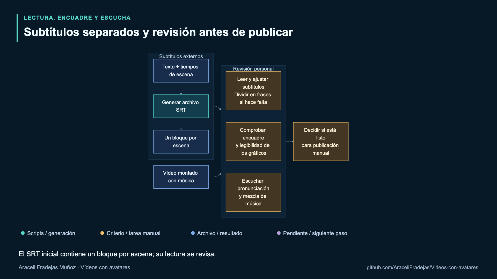</a>

Los textos y tiempos de escena permiten generar un archivo SRT independiente. Cada bloque inicial corresponde a una escena completa. Antes de publicarlo reviso si conviene dividirlo en frases para facilitar la lectura y compruebo que los tiempos acompañen la narración.

La revisión reúne tres tareas: leer los subtítulos, inspeccionar el encuadre y la legibilidad de los gráficos, y escuchar voz, pausas y música. La decisión de publicar sigue siendo personal. Esta revisión está descrita como práctica de producción; los scripts no registran una aprobación ni bloquean técnicamente los pasos siguientes hasta obtenerla.

[Fuente Mermaid](docs/esquemas-synthesia/mermaid/06c-subtitulos.mmd) · [Versión vectorial](docs/esquemas-synthesia/svg/06c-subtitulos.svg)

### 9. Una ruta propia para el vídeo largo

<a href="docs/esquemas-synthesia/png/07-formatos.png">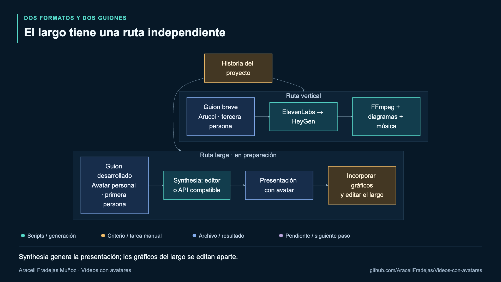</a>

El corto utiliza ElevenLabs, HeyGen y FFmpeg. El largo parte de un guion adaptado y de mi avatar personal en Synthesia. Es una ruta independiente: para trabajar en el editor de Synthesia no necesito generar antes una voz en ElevenLabs ni un vídeo en HeyGen.

Los scripts API incluidos son una alternativa cuando la cuenta y el avatar tienen acceso compatible. Solicitan y descargan una presentación con avatar; no insertan automáticamente los gráficos ni realizan la edición editorial del largo. Las láminas se prepararon para acompañar ese montaje. El esquema conserva el estado de planificación del guion, cuando el largo estaba en preparación; el [vídeo final](https://www.youtube.com/watch?v=hC1neS7fEbk) ya está publicado.

[Fuente Mermaid](docs/esquemas-synthesia/mermaid/07-formatos.mmd) · [Versión vectorial](docs/esquemas-synthesia/svg/07-formatos.svg)

### 10. Repositorio público, producción local y proveedores externos

<a href="docs/esquemas-synthesia/png/08a-datos.png">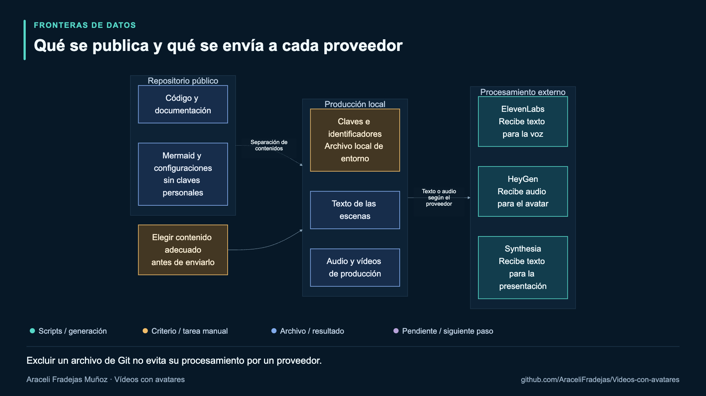</a>

El repositorio público contiene código, documentación, diagramas y configuraciones sin claves personales. En el entorno local mantengo las claves y los archivos de producción excluidos de Git. Esa separación facilita compartir el proceso sin incluir los recursos personales utilizados para generarlo.

También debo tener presente qué información sale del entorno local: ElevenLabs recibe texto para generar la voz; HeyGen recibe audio para animar el avatar; Synthesia recibe el texto de la presentación cuando utilizo su API. Elegir contenido adecuado antes de enviarlo sigue siendo una decisión personal. Excluir un archivo de Git no equivale a cifrarlo ni controla su retención o tratamiento en un proveedor.

[Fuente Mermaid](docs/esquemas-synthesia/mermaid/08a-datos.mmd) · [Versión vectorial](docs/esquemas-synthesia/svg/08a-datos.svg)

### 11. La licencia del código y los permisos de los recursos

<a href="docs/esquemas-synthesia/png/08b-permisos.png">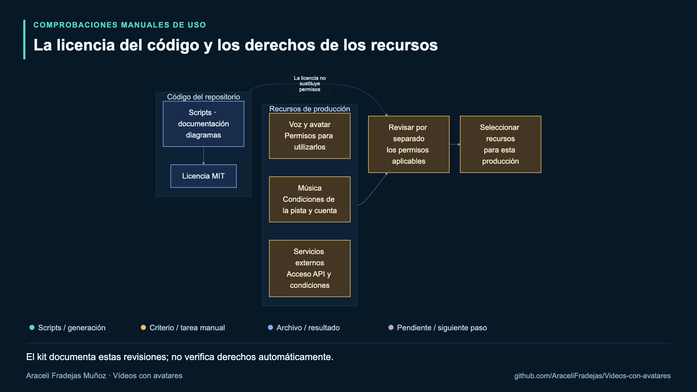</a>

La licencia MIT cubre el código, la documentación y los diagramas del kit. Por separado, las voces, los avatares, la música y los servicios tienen condiciones propias. Poder reutilizar un script no concede por sí mismo derechos sobre los materiales que ese script procesa.

Antes de producir una versión debo revisar el acceso de mis cuentas y los permisos aplicables a cada recurso. En la música, esto incluye las condiciones de la pista y del plan utilizado. El gráfico representa comprobaciones manuales documentadas; el sistema no verifica automáticamente titularidad, consentimiento o licencias ni constituye una certificación de cumplimiento.

[Fuente Mermaid](docs/esquemas-synthesia/mermaid/08b-permisos.mmd) · [Versión vectorial](docs/esquemas-synthesia/svg/08b-permisos.svg)

### 12. Reutilización y consulta para evitar repeticiones

<a href="docs/esquemas-synthesia/png/09a-costes.png">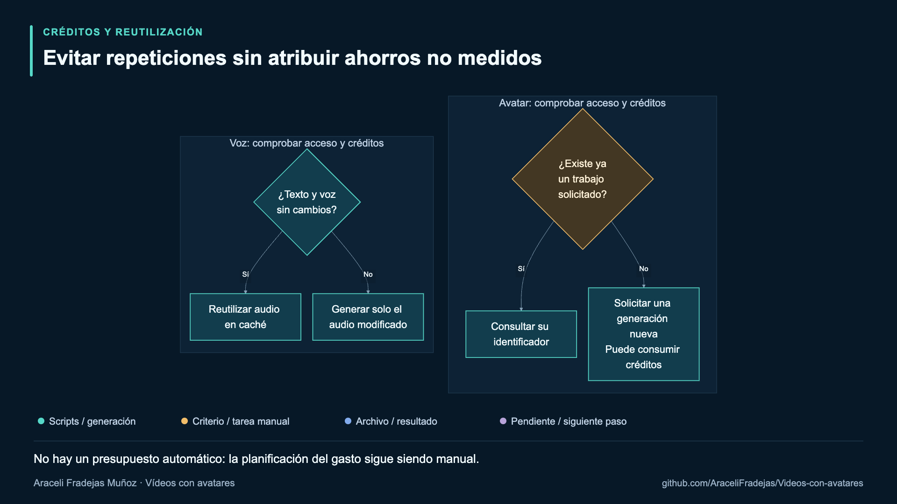</a>

Antes de producir una serie compruebo el acceso a las API y los créditos disponibles. En la voz, la caché permite reutilizar un audio que no ha cambiado según la huella definida. En el vídeo, conservar y consultar un trabajo existente evita confundir una consulta de estado con una solicitud nueva.

Estas medidas ayudan a controlar repeticiones, pero no forman un sistema presupuestario. Los generadores de avatares solicitan un trabajo nuevo cada vez que se ejecutan y pueden consumir créditos. No hay estimador, límite de gasto ni contabilidad automática; tampoco se ha medido un ahorro económico atribuible al kit.

[Fuente Mermaid](docs/esquemas-synthesia/mermaid/09a-costes.mmd) · [Versión vectorial](docs/esquemas-synthesia/svg/09a-costes.svg)

### 13. Pruebas de código y validación audiovisual

<a href="docs/esquemas-synthesia/png/09b-evidencia.png">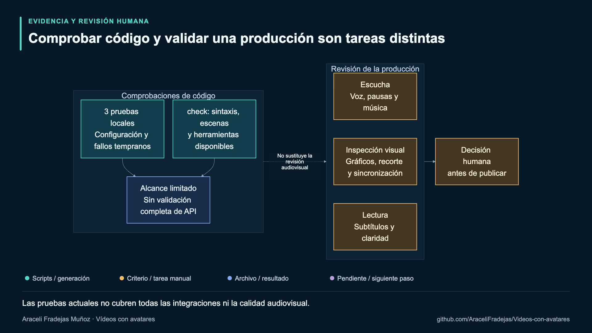</a>

Las tres pruebas locales actuales comprueban configuración, prioridad de variables y fallo temprano de HeyGen si faltan clave o avatar. El comando `check` revisa sintaxis JavaScript, estructura de las escenas del ejemplo, fuentes Mermaid y presencia de herramientas. Son comprobaciones útiles dentro de un alcance definido.

La calidad de una producción necesita además escucha, inspección visual y revisión de subtítulos. Las pruebas no validan todos los contratos API ni los filtros de montaje y mezcla. La decodificación de un MP4 comprueba su integridad técnica, pero no demuestra por sí sola que la narración se entienda o que los gráficos resulten legibles.

[Fuente Mermaid](docs/esquemas-synthesia/mermaid/09b-evidencia.mmd) · [Versión vectorial](docs/esquemas-synthesia/svg/09b-evidencia.svg)

### 14. Valor, integración, evidencia y responsabilidad

<a href="docs/esquemas-synthesia/png/10-criterio.png">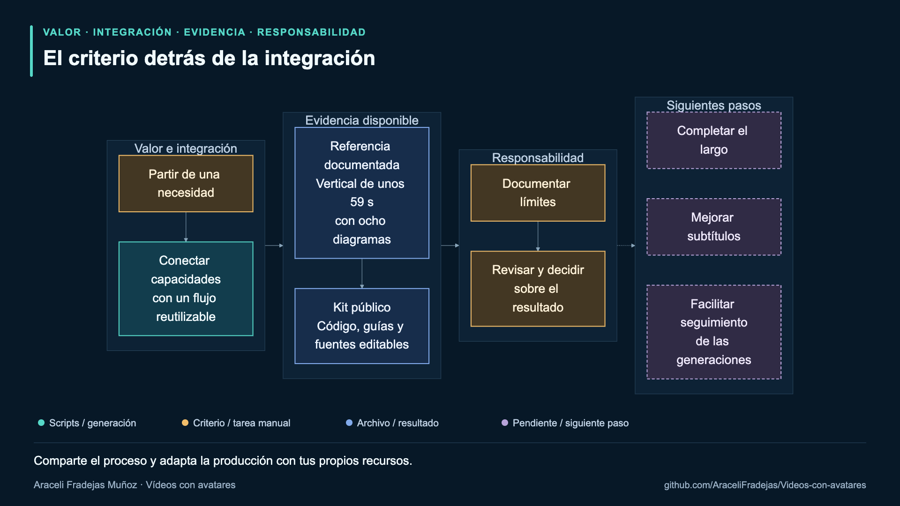</a>

El cierre conecta cuatro ideas: partir de una necesidad, integrar capacidades, documentar qué evidencia existe y conservar la responsabilidad sobre el resultado. La referencia disponible es el corto de unos 59 segundos con ocho diagramas; los materiales audiovisuales personales permanecen fuera del repositorio.

Lo reutilizable es el proceso, acompañado de código, guías y fuentes editables. El esquema recoge los siguientes pasos que definí al preparar el guion: completar el largo, mejorar la lectura de los subtítulos y facilitar el seguimiento de las generaciones. La publicación del largo ya se ha completado. Las otras mejoras siguen planteadas; los recuadros se conservan como registro de aquella fase de planificación.

[Fuente Mermaid](docs/esquemas-synthesia/mermaid/10-criterio.mmd) · [Versión vectorial](docs/esquemas-synthesia/svg/10-criterio.svg)

## Resultado de esta edición

El corto revisado dura **59,27 segundos** y contiene ocho diagramas Mermaid. Explica las funciones de ElevenLabs, HeyGen, FFmpeg, Synthesia y Suno. La escena musical describe explícitamente la creación de la pista en Suno y su mezcla bajo la voz.

El MP4 final utiliza H.264/AAC, 1080 × 1920 y 30 fps. Se ha comprobado su decodificación completa y se han inspeccionado fotogramas del montaje. Esto no sustituye la escucha final ni garantiza cómo tratará el archivo cada plataforma.

El [largo de Synthesia](https://www.youtube.com/watch?v=hC1neS7fEbk) también está terminado y publicado. La fuente dura **510,283 segundos** y conserva su imagen en 1920 × 1080 a 30 fps. Para cubrir todo el vídeo he utilizado tres repeticiones de la pista de Suno, con transiciones cruzadas de cuatro segundos, fundidos de entrada y salida y reducción automática de música bajo la voz.

El flujo de imagen se ha copiado sin recodificación: su huella SHA-256 coincide entre la fuente y la versión con música. El MP4 final se ha decodificado completamente con FFmpeg sin errores. Estas comprobaciones describen el archivo local entregado; los enlaces anteriores permiten acceder a las publicaciones de YouTube.

## Qué automatizo y qué decido

| Automatización | Trabajo de producción |
| --- | --- |
| Solicitar voz por escenas. | Elegir la historia y escribir el guion. |
| Medir duraciones y generar tiempos. | Revisar pausas, pronunciación y sincronización. |
| Solicitar y descargar el avatar. | Elegir el avatar y su encuadre. |
| Exportar Mermaid a imágenes. | Diseñar diagramas comprensibles y legibles. |
| Componer vídeo y mezclar música. | Seleccionar la pista y revisar el equilibrio con la voz. |
| Crear un archivo SRT. | Revisar y adaptar sus bloques antes de publicar. |

## Aprendizajes

La continuidad entre herramientas depende de contratos sencillos: texto, audio, tiempos, imágenes e identificadores de trabajo. Separar esos archivos hace más fácil corregir una escena y entender en qué paso aparece un problema.

La automatización también necesita límites claros. Los proveedores procesan trabajos de forma asíncrona, los encuadres cambian entre avatares y una buena presentación depende de decisiones narrativas. Por eso conservo una revisión humana antes de publicar y documento las limitaciones de los scripts.

## Próximas mejoras

- Mantener los enlaces de las publicaciones y documentar las siguientes versiones de los vídeos.
- Configurar el recorte del avatar sin editar el filtro de FFmpeg.
- Facilitar subtítulos divididos en frases.
- Ampliar la validación en Linux y WSL2.
- Incorporar un registro de trabajos que ayude a consultar las generaciones sin repetirlas.

Estas mejoras están planteadas; no se describen como funciones ya implementadas.

## Reutilización

La [guía completa](docs/EMPEZAR.md) permite seguir el proceso con cuentas y recursos propios. El código, documentación y diagramas se distribuyen bajo licencia MIT. Los servicios y los contenidos personales conservan sus propias condiciones.

**Araceli Fradejas Muñoz** · [GitHub](https://github.com/AraceliFradejas)
