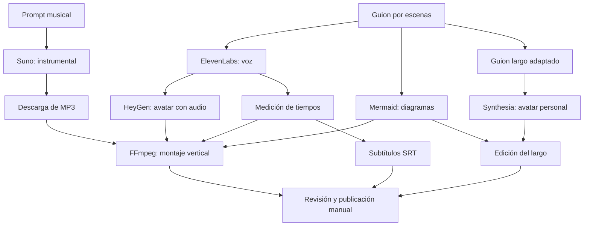

# Vídeos con avatares · IA aplicada a la comunicación de proyectos

**Proyecto creado y dirigido por Araceli Fradejas Muñoz.**

Apóyate en avatares para crear vídeos explicativos de tus proyectos. Te dejo cómo hacerlo aquí de forma sencilla, con guiones, diagramas y scripts que puedes adaptar a tu propia voz, imagen e historia.

Este proyecto nace de una necesidad de mi portfolio: explicar lo que desarrollo de forma visual y cercana sin empezar cada producción desde cero. He organizado las tareas que se repiten y conectado varias herramientas para crear vídeos verticales y presentaciones largas.

**[Empieza paso a paso](docs/EMPEZAR.md)** · [Memoria del proyecto](MEMORIA.md) · [Arquitectura](docs/ARQUITECTURA.md) · [Ejemplo completo](projects/avatar-pipeline/README.md)

## Qué puedes crear

| Formato | Presentación | Herramientas y resultado |
| --- | --- | --- |
| TikTok, Shorts y Reels | En mi serie presenta Arucci, mi avatar, y habla de mí en tercera persona. | ElevenLabs + HeyGen + Mermaid + FFmpeg. Vertical 1080 × 1920, avatar arriba y gráficos abajo. |
| YouTube largo | Mi avatar personal y narración en primera persona. | Synthesia para la presentación y edición visual posterior. Guion y configuración API incluidos. |
| Banda sonora | Instrumental que deja espacio a la narración. | Creación opcional en Suno, descarga manual y mezcla local con FFmpeg. |

Cada persona utiliza **sus propias claves, voz y avatares**. Los recursos personales de mi serie no se distribuyen.

## Cómo funciona



La generación de voz, la animación del avatar y el montaje son pasos separados. Los scripts guardan los tiempos de cada escena y los identificadores de generación se consultan después para descargar los vídeos terminados. El criterio narrativo y la revisión final siguen siendo parte de mi trabajo de producción.

## Instalación rápida

Necesitas **Node.js 22 o superior, npm, FFmpeg, jq y zsh**. En Windows utiliza WSL2. La [guía de instalación](docs/EMPEZAR.md) explica las herramientas para cada sistema.

```bash
git clone https://github.com/AraceliFradejas/Videos-con-avatares.git
cd Videos-con-avatares
npm ci
cp .env.example .env
npm run check
npm test
npm run diagrams -- projects/avatar-pipeline
```

Estos comandos comprueban el proyecto y generan los gráficos sin consumir las API de voz o vídeo. Para producir tu vídeo, completa `.env` localmente y sigue los [comandos de producción](docs/EMPEZAR.md#4-generar-voz--llamada-a-elevenlabs).

## Documentación

| Documento | Contenido |
| --- | --- |
| [Memoria](MEMORIA.md) | Motivación, objetivos, desarrollo, resultados y aprendizajes. |
| [Guía paso a paso](docs/EMPEZAR.md) | Instalación, claves, generación, descarga, montaje y problemas habituales. |
| [Arquitectura](docs/ARQUITECTURA.md) | Flujo completo, contratos de datos y límites del sistema. |
| [Herramientas y configuración](docs/HERRAMIENTAS.md) | Qué aporta cada servicio, qué debes configurar y qué permanece local. |
| [Decisiones técnicas](docs/DECISIONES.md) | Escenas, dos formatos, Mermaid, subtítulos externos y música. |
| [Verificación](docs/VERIFICACION.md) | Comprobaciones realizadas y alcance de los resultados. |
| [Ejemplo de Arucci](projects/avatar-pipeline/README.md) | Guiones, configuraciones y ocho gráficos editables. |
| [Música con Suno](projects/avatar-pipeline/publishing/musica.md) | Dirección musical y prompt instrumental de referencia. |
| [Plantilla](templates/project/README.md) | Base para escribir y producir una historia distinta. |

## Estructura

```text
config/                   Tema visual de Mermaid
scripts/lib/              Lectura de configuración local
scripts/audio/            Voz ElevenLabs y mezcla de música
scripts/avatars/          Generación y descarga HeyGen / Synthesia
scripts/video/            Montaje vertical con FFmpeg
scripts/subtitles/        SRT a partir de tiempos
projects/avatar-pipeline/ Ejemplo: guiones, Mermaid y configuraciones
templates/project/        Plantilla para tu propio proyecto
docs/                     Guías, arquitectura y decisiones
tests/                    Pruebas locales sin consumo de API
```

Los resultados van a `projects/<nombre>/output/`, excluido de Git. Conserva los identificadores devueltos por los proveedores para consultar un trabajo existente sin solicitar otra generación.

## Estado del proyecto

El ejemplo vertical está producido: **59,27 segundos**, ocho diagramas, voz de ElevenLabs, Arucci en HeyGen y música creada en Suno. El MP4 final utiliza H.264/AAC, 1080 × 1920 y 30 fps. Se conserva también una versión sin música y un SRT externo.

El guion largo está preparado; el montaje personal en Synthesia está en curso. La ruta API de Synthesia es una alternativa incluida en el código y no se ha vuelto a ejecutar en esta edición.

No es una aplicación de un solo botón: no hay publicación automática en redes, alineación por palabra ni reintentos automáticos de generaciones. El recorte vertical está preparado para una fuente de 720 × 1280 y puede necesitar cambios con otro encuadre. La [verificación](docs/VERIFICACION.md) detalla qué se ha comprobado.

## Uso de servicios y recursos

Necesitas acceso API y recursos compatibles para los proveedores que elijas. Las generaciones pueden consumir créditos. Una suscripción al editor no garantiza acceso a su API. Suno se utiliza mediante descarga manual del audio y no requiere clave en este proyecto.

El repositorio incluye código, documentación y diagramas; los vídeos, claves, voces, avatares y música personal permanecen fuera. Comprueba las condiciones de uso de tus recursos antes de publicar. La licencia MIT del código no concede derechos sobre servicios o contenidos de terceros.

## Contribuir

Puedes proponer mejoras siguiendo [CONTRIBUTING.md](CONTRIBUTING.md). Para incidencias de configuración y credenciales, consulta [SECURITY.md](SECURITY.md). El código, documentación y diagramas se comparten bajo [licencia MIT](LICENSE).

## Autora

**© 2026 Araceli Fradejas Muñoz · Vídeos con avatares**

[GitHub](https://github.com/AraceliFradejas) ·
[LinkedIn](https://www.linkedin.com/in/araceli-fradejas-munoz-transformaciondigital/) ·
[Medium](https://medium.com/@araceli.fradejas) ·
[YouTube](https://www.youtube.com/@aracelifradejasmunoz2758)
