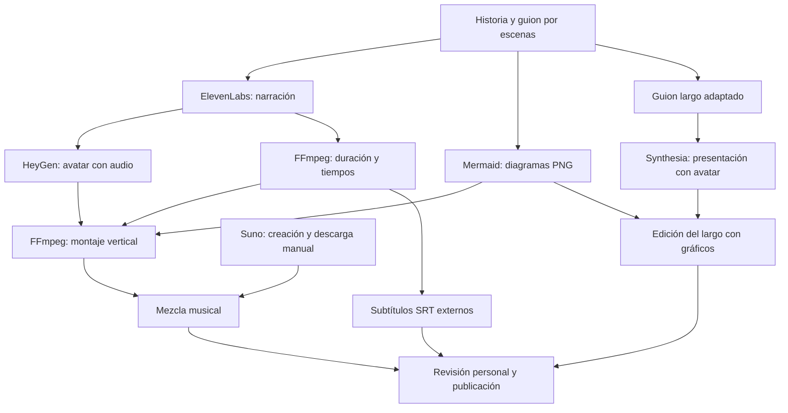
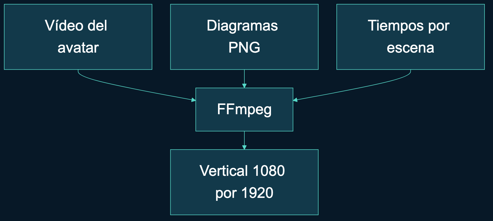
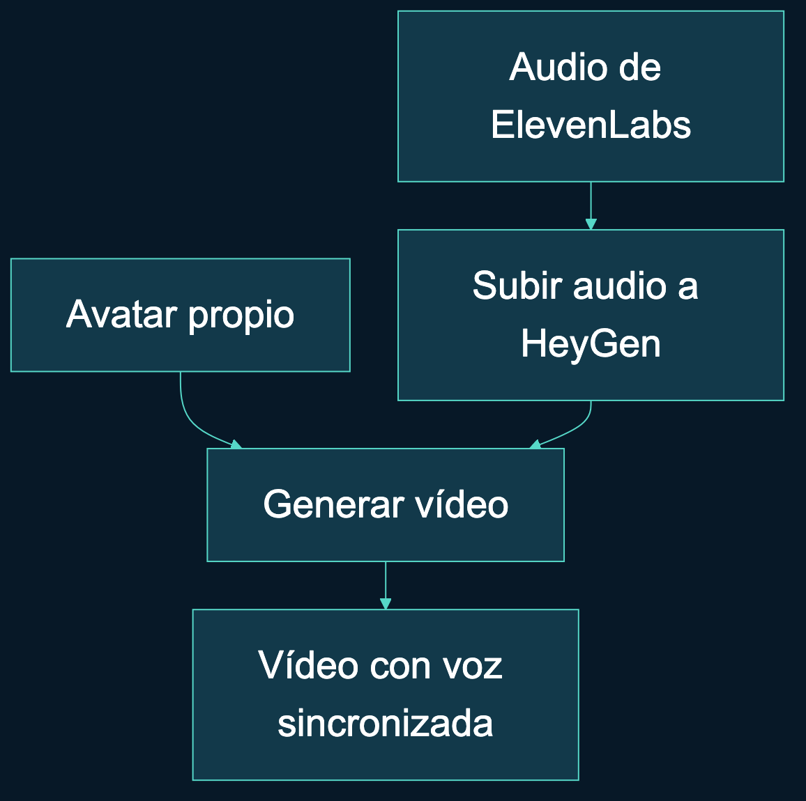
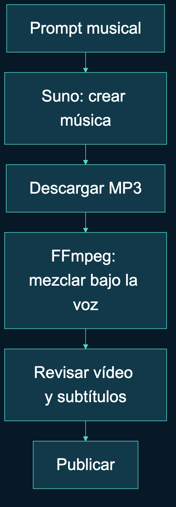

# Vídeos con avatares

[Versión en castellano](#versión-en-castellano) · [English version](#english-version)

## Versión en castellano

Proyecto personal de **Araceli Fradejas Muñoz** para comunicar proyectos de desarrollo mediante inteligencia artificial, avatares y producción audiovisual.

> **Cada proyecto tiene una historia. El reto es hacer que se entienda.**

Vídeos con avatares reúne el proceso que utilizo para explicar mis proyectos en TikTok, YouTube Shorts, Reels y vídeos largos de YouTube. Incluye guiones por escenas, diagramas Mermaid y scripts para conectar voz, avatar y montaje. Puedes adaptarlo con tus propias claves, tu voz y tu imagen.

**Para empezar:** [Guía paso a paso](docs/EMPEZAR.md). **Para conocer el proyecto:** [Memoria](MEMORIA.md). **Para ver un ejemplo:** [Guion y diagramas de Arucci](projects/avatar-pipeline/README.md).

### Una historia personal

Mis proyectos de desarrollo tienen temas, decisiones y aprendizajes que quiero compartir. En KelseTS Talks, KelseTS Cars y el resto de mi portfolio, la presentación visual también forma parte de cómo cuento lo que he construido.

Al preparar varios vídeos, se repetían las mismas tareas: elegir qué explicar, escribir la narración, preparar imágenes, generar una voz y montar el resultado. Quería conservar una identidad propia y, al mismo tiempo, organizar ese trabajo para poder reutilizarlo.

Así nace este proyecto. En los vídeos breves utilizo a **Arucci**, mi avatar narrador, que habla de mí en tercera persona. En los largos utilizo mi avatar personal de **Synthesia** y narro en primera persona, con más espacio para explicar el propósito, las decisiones y los aprendizajes.

También he incorporado música creada con **Suno**. La pista del ejemplo, *Warm Analog Pad*, acompaña la narración sin ocupar su lugar. El propio corto explica cómo está hecho: es una demostración del proceso que comparto aquí.

### Qué puedes hacer con el proyecto

- Preparar una historia dividida en escenas, con texto hablado y un visual asociado.
- Generar la voz con ElevenLabs y reutilizar el audio de las escenas que no cambian.
- Crear un vídeo de tu avatar en HeyGen a partir de ese audio.
- Escribir diagramas con Mermaid y exportarlos a imágenes para el montaje.
- Combinar avatar y gráficos en un vídeo vertical 50/50 con FFmpeg.
- Crear una pista instrumental en Suno, descargarla y mezclarla bajo la voz.
- Generar un archivo SRT independiente a partir de los tiempos de las escenas.
- Preparar un guion largo para el editor de Synthesia o utilizar la ruta API cuando tu cuenta y avatar tengan acceso compatible.

El kit utiliza tus propios recursos. No crea ni distribuye la voz o los avatares personales del ejemplo, y la publicación en redes se realiza manualmente.

### Estado actual

El corto de referencia está producido: **59,27 segundos**, ocho diagramas Mermaid y música creada con Suno. El montaje utiliza H.264/AAC, 1080 × 1920 y 30 fps. Conservo una versión con música, otra limpia y los subtítulos externos.

El vídeo largo está en preparación en Synthesia. El repositorio incluye un guion y una ruta API para solicitar y descargar la presentación; la incorporación de los gráficos y la edición del largo requieren trabajo adicional.

La [verificación](docs/VERIFICACION.md) distingue pruebas del código, comprobaciones del archivo audiovisual y límites pendientes. Los vídeos y audios personales se conservan localmente y no están incluidos en Git.

### Estructura y tecnologías

He separado guiones, configuraciones, recursos y resultados para localizar cada parte de la producción y poder revisar una escena sin perder el conjunto.

```text
config/                   Tema visual de Mermaid
scripts/
  audio/                  Generación de voz y mezcla musical
  avatars/                Generación y descarga HeyGen / Synthesia
  video/                  Montaje vertical con FFmpeg
  subtitles/              SRT a partir de tiempos
  lib/                    Lectura de configuración local
projects/avatar-pipeline/
  config/                 Texto hablado y visual de cada escena
  assets/diagrams/        Fuentes Mermaid editables
  assets/screenshots/     Diagramas exportados a PNG
  publishing/             Textos de publicación y proceso musical
  guion.md                Guion del corto
  guion-youtube.md        Guion largo de referencia
templates/project/        Base para contar otro proyecto
docs/                     Guías, arquitectura y decisiones
tests/                    Pruebas sin consumo de API
```

**Automatización:** Node.js, JavaScript y zsh. **Voz y avatares:** ElevenLabs, HeyGen y Synthesia. **Gráficos:** Mermaid y Mermaid CLI. **Audio y vídeo:** FFmpeg. **Música:** Suno, con descarga manual. **Configuración:** JSON, archivos de entorno y jq. **Pruebas:** `node:test` y GitHub Actions.

El intercambio entre herramientas se realiza mediante archivos: texto, MP3, PNG, JSON de tiempos y MP4. Esa separación permite inspeccionar los resultados de cada paso. No hay un orquestador que supervise toda la producción.

### Instalación local

Necesitas **Node.js 22 o posterior, npm, FFmpeg, jq y zsh**. En Windows utiliza WSL2. La [guía completa](docs/EMPEZAR.md) incluye instrucciones para macOS y Linux.

1. Clona el repositorio y entra en la carpeta:

   ```bash
   git clone https://github.com/AraceliFradejas/Videos-con-avatares.git
   cd Videos-con-avatares
   ```

2. Instala las dependencias y prepara la configuración local:

   ```bash
   npm ci
   cp .env.example .env
   ```

3. Comprueba el proyecto y genera los diagramas del ejemplo:

   ```bash
   npm run check
   npm test
   npm run diagrams -- projects/avatar-pipeline
   ```

Estos pasos no generan voz ni vídeo de pago. Mermaid CLI descarga un navegador mediante Puppeteer durante la instalación; necesita conexión y espacio disponible.

### Variables de entorno y recursos propios

Completa `.env` con los valores de los proveedores que vayas a utilizar. Una suscripción al editor no garantiza acceso a su API ni a todos sus avatares.

| Servicio | Variables | Para qué se utilizan |
| --- | --- | --- |
| ElevenLabs | `ELEVENLABS_API_KEY`, `ELEVENLABS_VOICE_ID` | Generar la narración con tu voz disponible. |
| HeyGen | `HEYGEN_API_KEY`, `HEYGEN_AVATAR_ID` | Crear el avatar hablando con el audio generado. |
| Synthesia | `SYNTHESIA_API_KEY`, `SYNTHESIA_AVATAR_ID` | Ruta API opcional para la presentación larga. |
| FFmpeg | `FFMPEG_BIN` | Ruta opcional al ejecutable cuando no está en PATH. |

Suno se utiliza desde su interfaz y mediante descarga del archivo de audio; este proyecto no requiere una clave de Suno. Para montar el largo manualmente en el editor de Synthesia tampoco necesitas ejecutar sus scripts API.

Los scripts de Node combinan `.env`, el archivo específico del proveedor cuando existe y las variables exportadas en la terminal, que tienen prioridad. Las claves, los resultados y la carpeta de música prevista están excluidos de Git. Consulta [Herramientas](docs/HERRAMIENTAS.md) y [Seguridad](SECURITY.md).

### Cómo preparo un vídeo



La [guía paso a paso](docs/EMPEZAR.md) contiene los comandos de generación, consulta, descarga, montaje y mezcla. Cada solicitud de vídeo devuelve un identificador que debo conservar para consultar ese mismo trabajo; volver a ejecutar la generación solicita uno nuevo y puede consumir créditos.

Los resultados se guardan en `projects/<nombre>/output/`. Para crear otra historia, parte de la [plantilla](templates/project/README.md) y sustituye el texto, los visuales y las referencias a mi identidad por los tuyos.

### Decisiones y aprendizajes

Separar voz, avatar y montaje me permite entender dónde se produce cada resultado. La caché de ElevenLabs reutiliza audio cuando coinciden el texto, la voz y los ajustes contemplados por su huella. Cuando cambio una escena, reviso también su visual y sus tiempos.

Para explicar el proceso en móvil he repartido los gráficos en varios planos. Mantengo las fuentes Mermaid como texto para poder editarlas y revisar sus cambios en Git. El montaje vertical conserva a Arucci arriba y la explicación visual abajo.

La música se elige y descarga manualmente desde Suno; FFmpeg incorpora el audio y reduce su nivel bajo la narración. Los subtítulos quedan en un SRT externo con un bloque por escena. Su lectura y división en frases siguen necesitando revisión.

También documento los límites: el recorte del avatar depende del encuadre, los archivos de guion y configuración se mantienen coherentes manualmente, y no hay presupuesto automático ni registro operativo de todas las generaciones. Lo explico en la [memoria](MEMORIA.md) y en [Decisiones](docs/DECISIONES.md).

### Pruebas y gráficos del ejemplo

Las **tres pruebas automatizadas** cubren la configuración de entorno, su prioridad y el fallo temprano de HeyGen cuando faltan clave o avatar. `npm run check` comprueba sintaxis JavaScript, escenas, fuentes Mermaid y presencia de herramientas. [GitHub Actions](https://github.com/AraceliFradejas/Videos-con-avatares/actions) ejecuta estas comprobaciones en Ubuntu con Node.js 22.

El corto de referencia se ha montado en macOS y su MP4 se ha decodificado completamente con FFmpeg sin errores. Las pruebas del código no verifican todas las API ni sustituyen la escucha y la revisión visual. Linux y WSL2 tienen instrucciones, pero la producción completa no se ha validado allí.

Estos gráficos forman parte del ejemplo. Puedes abrirlos a tamaño completo y modificar sus [fuentes Mermaid](projects/avatar-pipeline/assets/diagrams/).

<a href="projects/avatar-pipeline/assets/screenshots/05-montaje.png"></a>

<a href="projects/avatar-pipeline/assets/screenshots/04-avatar.png"></a>

<a href="projects/avatar-pipeline/assets/screenshots/06-revision.png"></a>

### Documentación

- [Memoria del proyecto](MEMORIA.md).
- [Instalación y producción paso a paso](docs/EMPEZAR.md).
- [Arquitectura y contratos entre herramientas](docs/ARQUITECTURA.md).
- [Herramientas, cuentas y configuración](docs/HERRAMIENTAS.md).
- [Decisiones de producción](docs/DECISIONES.md) y [verificación](docs/VERIFICACION.md).
- [Ejemplo de Arucci](projects/avatar-pipeline/README.md), [guion corto](projects/avatar-pipeline/guion.md) y [guion largo de referencia](projects/avatar-pipeline/guion-youtube.md).
- [Música con Suno y prompt instrumental](projects/avatar-pipeline/publishing/musica.md).
- [Plantilla de proyecto](templates/project/README.md), [contribuciones](CONTRIBUTING.md) y [seguridad](SECURITY.md).

### Otros proyectos de mi portfolio

Este proceso acompaña la comunicación de mis proyectos de desarrollo. Puedes conocer dos de ellos aquí:

| Proyecto | Enfoque | Repositorio |
| --- | --- | --- |
| KelseTS Talks | Eventos, ponentes y gestión de asistencia. | [Ver proyecto](https://github.com/AraceliFradejas/RTC-PROYECTO10-FULL-STACK-JAVASCRIPT). |
| KelseTS Cars | Catálogo de vehículos, sedes y coordinación de citas. | [Ver proyecto](https://github.com/AraceliFradejas/RTC-PROYECTO13-FULL-STACK-REACT). |

### Redes sociales

[GitHub](https://github.com/AraceliFradejas) · [LinkedIn](https://www.linkedin.com/in/araceli-fradejas-munoz-transformaciondigital/) · [X](https://x.com/AraceliFradejas) · [Medium](https://medium.com/@araceli.fradejas) · [YouTube](https://www.youtube.com/@aracelifradejasmunoz2758)

### Licencia y uso de recursos

El código, documentación y diagramas se comparten bajo [licencia MIT](LICENSE). Las voces, los avatares, la música y los servicios conservan sus propias condiciones; la licencia del código no sustituye los permisos necesarios para utilizarlos.

El texto y el audio se procesan en proveedores externos según el paso ejecutado. Debes elegir contenido adecuado para esos servicios y comprobar los derechos y el acceso de tus cuentas. El repositorio documenta estas revisiones, pero no valida automáticamente los permisos ni garantiza el tratamiento de datos por terceros.

### Autora

**Araceli Fradejas Muñoz**

Proyecto personal de integración de inteligencia artificial y comunicación audiovisual para mi portfolio.

---

## English version

[Volver a la versión en castellano](#versión-en-castellano)

Personal project by **Araceli Fradejas Muñoz** to communicate software projects through AI, avatars and audiovisual production.

> **Every project has a story. The challenge is making it understandable.**

Vídeos con avatares brings together the workflow I use to explain my projects in TikTok videos, YouTube Shorts, Reels and longer YouTube presentations. It includes scene-based scripts, Mermaid diagrams and scripts connecting narration, avatar generation and editing. You can adapt it using your own keys, voice and avatar.

**Get started:** [Step-by-step guide](docs/EMPEZAR.md). **Project background:** [Project report](MEMORIA.md). **Example:** [Arucci script and diagrams](projects/avatar-pipeline/README.md). The linked technical documentation and spoken scripts are in Spanish.

### A personal story

My development projects have their own themes, decisions and lessons that I want to share. In KelseTS Talks, KelseTS Cars and the rest of my portfolio, visual presentation is also part of how I tell the story of what I have built.

Preparing several videos meant repeating the same tasks: choosing the message, writing narration, preparing images, generating a voice and editing the result. I wanted to keep a recognisable identity while organising a workflow I could reuse.

For short videos, **Arucci**, my narrator avatar, talks about me in the third person. For longer videos, I use my personal **Synthesia** avatar and speak in the first person, with more room to explain the purpose, decisions and lessons.

I also added music created with **Suno**. The example track, *Warm Analog Pad*, supports the narration. The short video explains how it was made, demonstrating the process shared in this repository.

### What you can do

- Plan a story as scenes with spoken text and an associated visual.
- Generate narration with ElevenLabs and reuse unchanged scene audio.
- Create a HeyGen avatar video using that audio.
- Write Mermaid diagrams and export them as images.
- Combine avatar and graphics in a vertical 50/50 composition with FFmpeg.
- Create an instrumental track in Suno, download it and mix it beneath the voice.
- Generate an external SRT file from scene timings.
- Prepare a longer Synthesia script or use the optional API route when your account and avatar support it.

The kit uses your own resources. My personal voice and avatars are not distributed, and social media publishing remains manual.

### Current status

The reference short has been produced: **59.27 seconds**, eight Mermaid diagrams and music created in Suno. It uses H.264/AAC, 1080 × 1920 and 30 fps. A clean version and external subtitles are also retained locally.

The longer video is being prepared in Synthesia. The repository provides a script and an API route for requesting and downloading the presentation; adding diagrams and editing the long video require further work.

[Verification](docs/VERIFICACION.md) distinguishes code tests, audiovisual file checks and outstanding limitations. Personal video and audio files are not included in Git.

### Structure and technologies

Scripts, scene configurations, visual assets and outputs are kept separately. `scripts/` contains audio, avatar, video and subtitle operations; `projects/avatar-pipeline/` contains the example; `templates/project/` provides a starting point; `docs/` and `tests/` contain documentation and local checks.

**Automation:** Node.js, JavaScript and zsh. **Voice and avatars:** ElevenLabs, HeyGen and Synthesia. **Graphics:** Mermaid and Mermaid CLI. **Audio and video:** FFmpeg. **Music:** Suno with manual download. **Configuration:** JSON, environment files and jq. **Tests:** `node:test` and GitHub Actions.

Tools exchange inspectable files: text, MP3, PNG, timing JSON and MP4. There is no end-to-end supervisor or workflow orchestrator.

### Local setup

Requires **Node.js 22 or later, npm, FFmpeg, jq and zsh**. Use WSL2 on Windows. Installation instructions for macOS and Linux are in the [complete guide](docs/EMPEZAR.md).

```bash
git clone https://github.com/AraceliFradejas/Videos-con-avatares.git
cd Videos-con-avatares
npm ci
cp .env.example .env
npm run check
npm test
npm run diagrams -- projects/avatar-pipeline
```

These commands prepare the project and graphics without generating paid voice or video content. Mermaid CLI downloads a browser through Puppeteer during installation.

### Environment variables and your own resources

| Service | Variables | Purpose |
| --- | --- | --- |
| ElevenLabs | `ELEVENLABS_API_KEY`, `ELEVENLABS_VOICE_ID` | Generate narration with an available voice. |
| HeyGen | `HEYGEN_API_KEY`, `HEYGEN_AVATAR_ID` | Animate an avatar using the generated audio. |
| Synthesia | `SYNTHESIA_API_KEY`, `SYNTHESIA_AVATAR_ID` | Optional API route for the long presentation. |
| FFmpeg | `FFMPEG_BIN` | Optional executable path when unavailable in PATH. |

Configure only the services you use. Access to an editor does not guarantee API access or compatibility with every avatar. Suno uses manual audio download and needs no API key in this project. Working manually in the Synthesia editor does not require running its API scripts.

Node scripts combine `.env`, a provider-specific file when present, and exported environment variables, which take precedence. Credentials, production outputs and the intended music folder are ignored by Git. See [Tools](docs/HERRAMIENTAS.md) and [Security](SECURITY.md).

### Production workflow

For vertical videos, scene text goes to ElevenLabs, audio goes to HeyGen, and FFmpeg combines the resulting avatar video with Mermaid images using measured scene durations. Music is created and downloaded in Suno, then mixed locally. Subtitles are generated separately.

The long video follows its own script and Synthesia route. It does not need to pass through ElevenLabs or HeyGen. Diagrams and editorial work are added afterwards.

The [production guide](docs/EMPEZAR.md) contains the generation, status, download, editing and mixing commands. Keep each returned video identifier to query the existing job. Running generation again requests a new job and may consume credits.

Outputs are stored in `projects/<name>/output/`. To tell another story, adapt the [template](templates/project/README.md), visuals and references to my presentation.

### Decisions and lessons

Separating voice, avatar and editing makes each result easier to inspect. ElevenLabs audio is reused when the text, voice and settings covered by its fingerprint match. Changes to narration also require reviewing visuals and timings.

For mobile viewing, I divide explanations across several diagrams. Mermaid sources remain editable text, while the vertical composition keeps Arucci above the visual explanation.

Music selection and download are manual. FFmpeg applies fades and reduces music beneath narration. The external SRT starts with one block per scene; reading and phrase breaks need review.

The documented limits include avatar-specific cropping, manual consistency between Markdown and JSON, and the absence of automatic budget controls or a complete generation log. See the [project report](MEMORIA.md) and [production decisions](docs/DECISIONES.md).

### Validation and example graphics

**Three automated tests** cover environment configuration, precedence and early HeyGen failure when a key or avatar is missing. `npm run check` checks JavaScript syntax, example scenes, Mermaid sources and local tool availability. [GitHub Actions](https://github.com/AraceliFradejas/Videos-con-avatares/actions) runs these checks on Ubuntu with Node.js 22.

The reference short was produced on macOS and its MP4 was fully decoded by FFmpeg without errors. Code tests do not cover every provider integration or replace listening and visual review. Linux and WSL2 instructions are provided, but the complete production has not been validated there.

The [example graphics](projects/avatar-pipeline/assets/screenshots/) and their [Mermaid sources](projects/avatar-pipeline/assets/diagrams/) are included. Personal audiovisual outputs are retained locally.

### Documentation

- [Project report](MEMORIA.md).
- [Setup and production guide](docs/EMPEZAR.md).
- [Architecture and data contracts](docs/ARQUITECTURA.md).
- [Tools and account configuration](docs/HERRAMIENTAS.md).
- [Production decisions](docs/DECISIONES.md) and [verification](docs/VERIFICACION.md).
- [Arucci example](projects/avatar-pipeline/README.md), [short script](projects/avatar-pipeline/guion.md) and [reference long script](projects/avatar-pipeline/guion-youtube.md).
- [Suno music workflow and prompt](projects/avatar-pipeline/publishing/musica.md).
- [Project template](templates/project/README.md), [contribution guide](CONTRIBUTING.md) and [security](SECURITY.md).

These documents and example scripts are in Spanish.

### Other portfolio projects

| Project | Focus | Repository |
| --- | --- | --- |
| KelseTS Talks | Events, speakers and attendance management. | [Explore](https://github.com/AraceliFradejas/RTC-PROYECTO10-FULL-STACK-JAVASCRIPT). |
| KelseTS Cars | Vehicle catalogue, locations and appointment coordination. | [Explore](https://github.com/AraceliFradejas/RTC-PROYECTO13-FULL-STACK-REACT). |

### Social links

[GitHub](https://github.com/AraceliFradejas) · [LinkedIn](https://www.linkedin.com/in/araceli-fradejas-munoz-transformaciondigital/) · [X](https://x.com/AraceliFradejas) · [Medium](https://medium.com/@araceli.fradejas) · [YouTube](https://www.youtube.com/@aracelifradejasmunoz2758)

### Licence and resource use

Code, documentation and diagrams are shared under the [MIT licence](LICENSE). Voices, avatars, music and services retain their own terms; the code licence does not grant rights to those resources.

Text and audio are processed by external providers depending on the production step. Choose suitable content and check your account access and resource permissions. The kit documents these reviews but does not automatically validate rights or guarantee third-party data handling.

### Author

**Araceli Fradejas Muñoz**

Personal AI integration and audiovisual communication project for my portfolio.

[Volver al inicio / Back to top](#vídeos-con-avatares)
