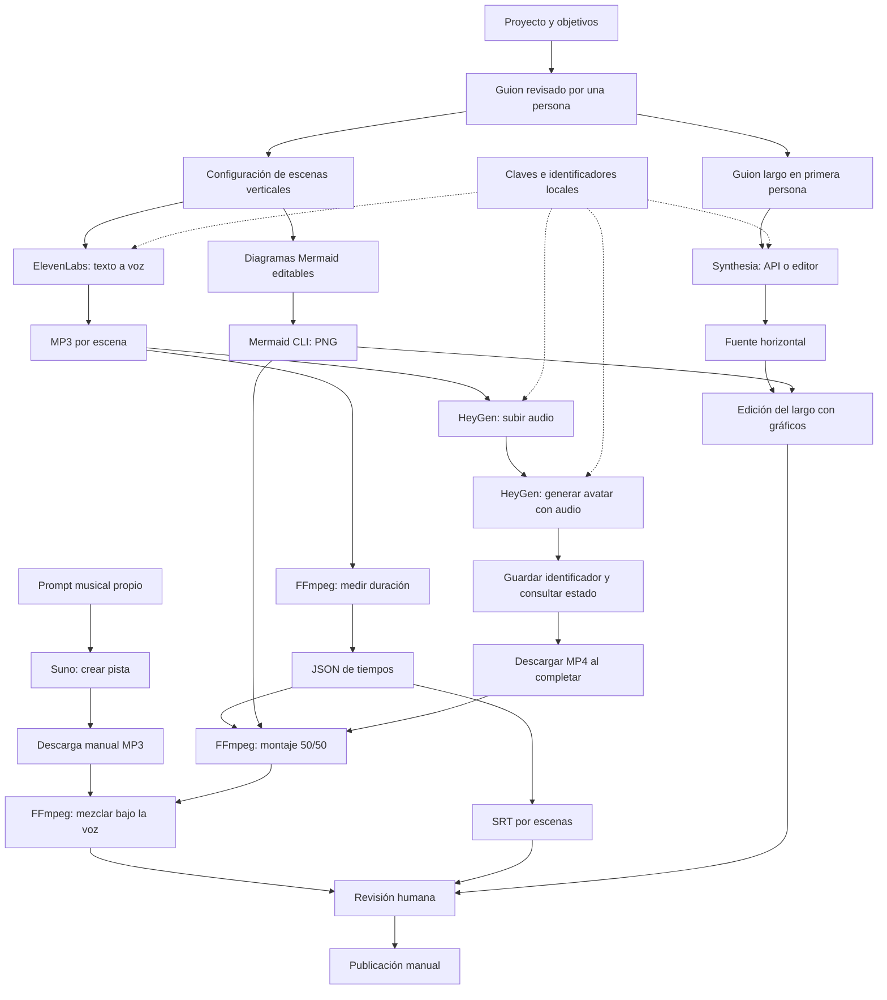

# Arquitectura del sistema

## Contratos de datos

- Configuración vertical: `project`, `title`, `scenes[]` con `text` y `visual`.
- Tiempos: `duration` total y `scenes[]` con `start`, `end`, `duration`, texto y visual originales.
- Diagramas: `.mmd` fuente y `.png` con el mismo nombre base que `visual`.
- Avatar: MP4 descargado con voz; el montaje usa ese audio.
- Configuración larga: `scenes[]` con `text`; los identificadores de avatar vienen del entorno.

## Límites

La caché de ElevenLabs evita regenerar escenas idénticas con la misma voz. No hay orquestador completo, cola de trabajos, reintentos de pago, alineación por palabra ni subida automática a plataformas. La revisión y el montaje editorial del largo siguen siendo parte del trabajo de producción.
