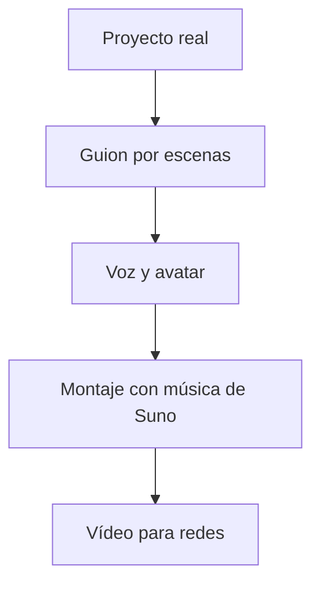
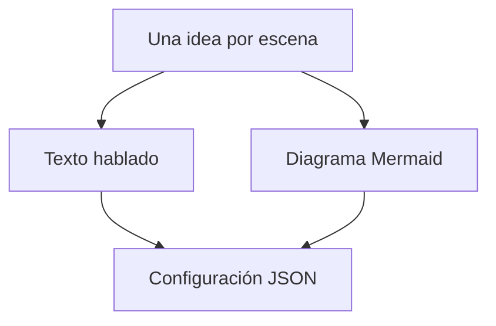
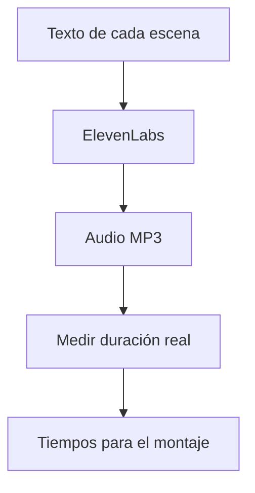
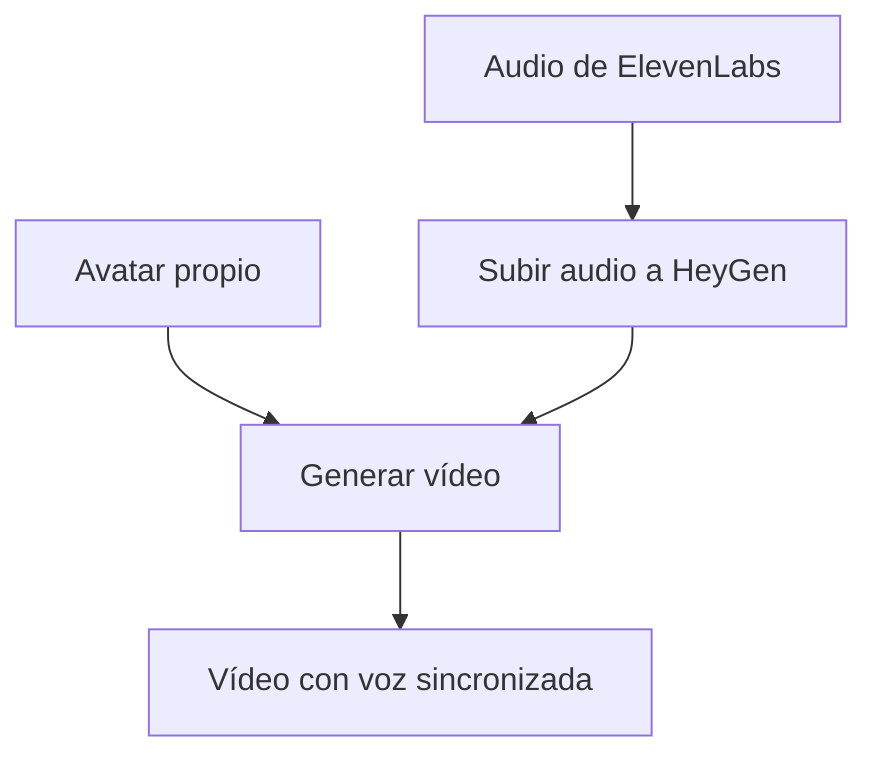
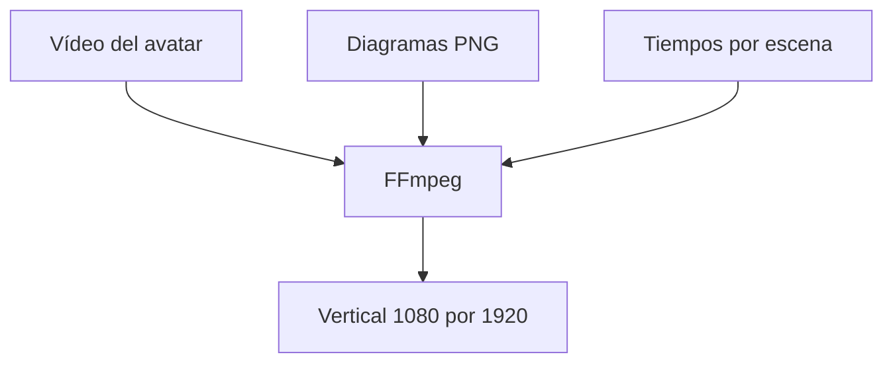
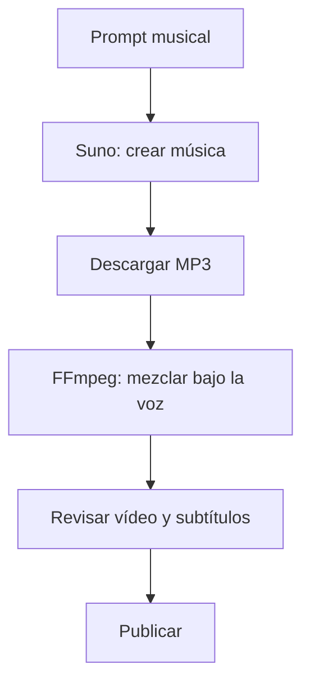
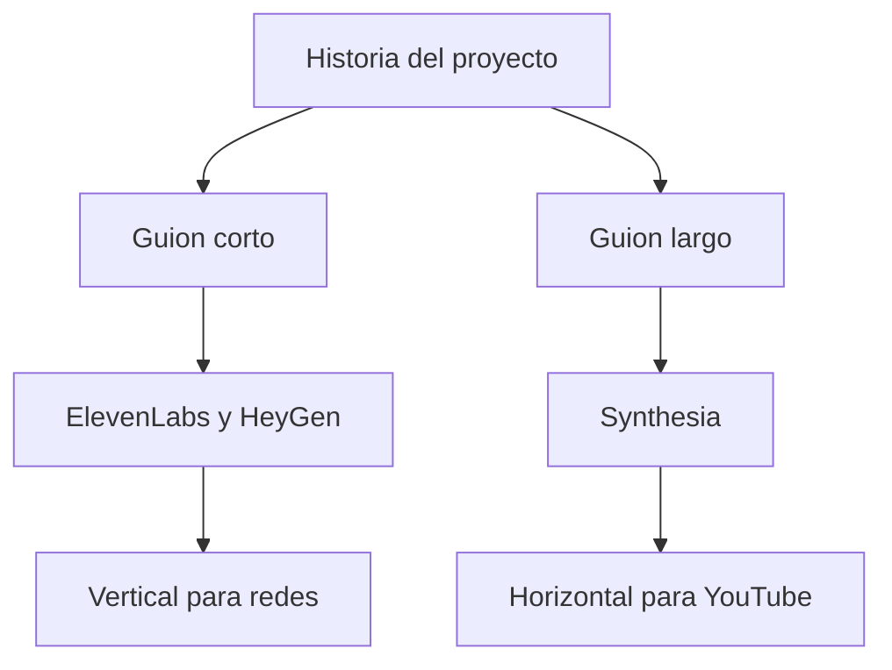
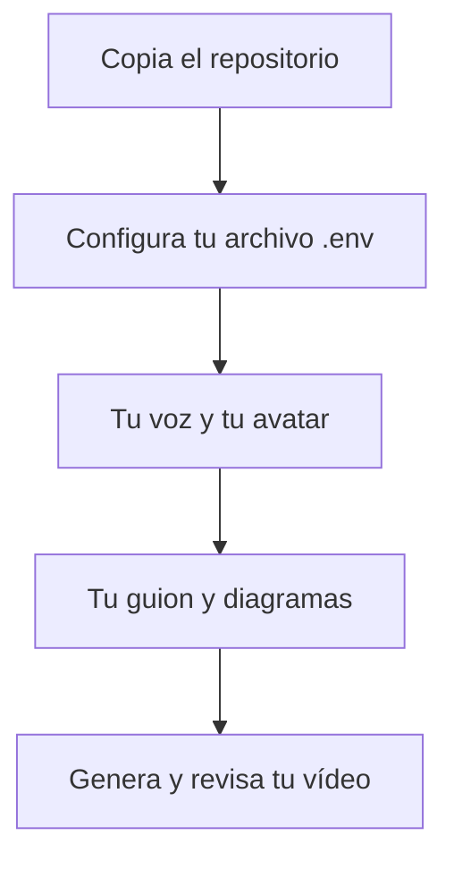

# Cómo creo vídeos con avatares

Corto vertical con Arucci. Duración de la narración revisada: 59,27 segundos. Ocho diagramas sucesivos, sin mostrar claves ni paneles privados. La grafía hablada es «Aruchi».

## Escena 1: 01-recorrido

**Texto hablado:** ¿Cómo se convierte un proyecto de programación en un vídeo como este? Con un proceso que conecta guiones, voz y avatares.

## Escena 2: 02-escenas

**Texto hablado:** Soy Aruchi, el avatar de Araceli. Ella prepara qué contar y qué gráfico acompaña cada frase.

## Escena 3: 03-voz

**Texto hablado:** ElevenLabs transforma cada texto en audio. Un script mide su duración para ajustar las imágenes a la narración.

## Escena 4: 04-avatar

**Texto hablado:** Después, HeyGen recibe ese audio y genera mi vídeo sincronizando la boca con la voz. La voz y la imagen son pasos distintos.

## Escena 5: 05-montaje

**Texto hablado:** FFmpeg combina el avatar arriba y los diagramas abajo. Los tiempos deciden cuándo cambia cada gráfico.

## Escena 6: 06-revision

**Texto hablado:** La música también la creamos con inteligencia artificial, usando Suno. FFmpeg la mezcla bajo mi voz. Araceli revisa el vídeo y los subtítulos antes de publicar.

## Escena 7: 07-formatos

**Texto hablado:** Para YouTube largo utiliza su avatar personal en Synthesia. Cada formato tiene su propio guion.

## Escena 8: 08-reutilizar

**Texto hablado:** El repositorio explica cómo reproducirlo con tus propias claves, tu voz y tu avatar. Este vídeo es la demostración. ¿Qué crearías tú?

## Dirección visual

Avatar en la mitad superior. Cada diagrama ocupa la inferior. Mostrar de 4 a 6 nodos con etiquetas breves; revelar o resaltar un paso por frase en edición si se desea. No reducir un diagrama grande hasta hacerlo ilegible. La explicación detallada del conjunto está en el README del kit público. Sin subtítulos incrustados.
